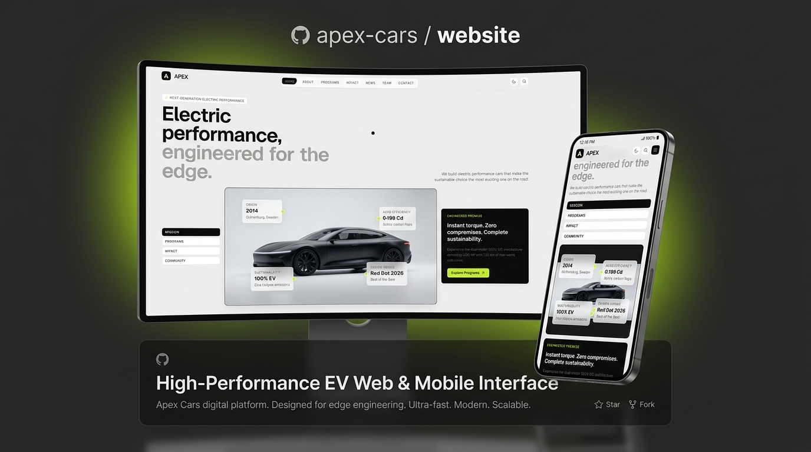
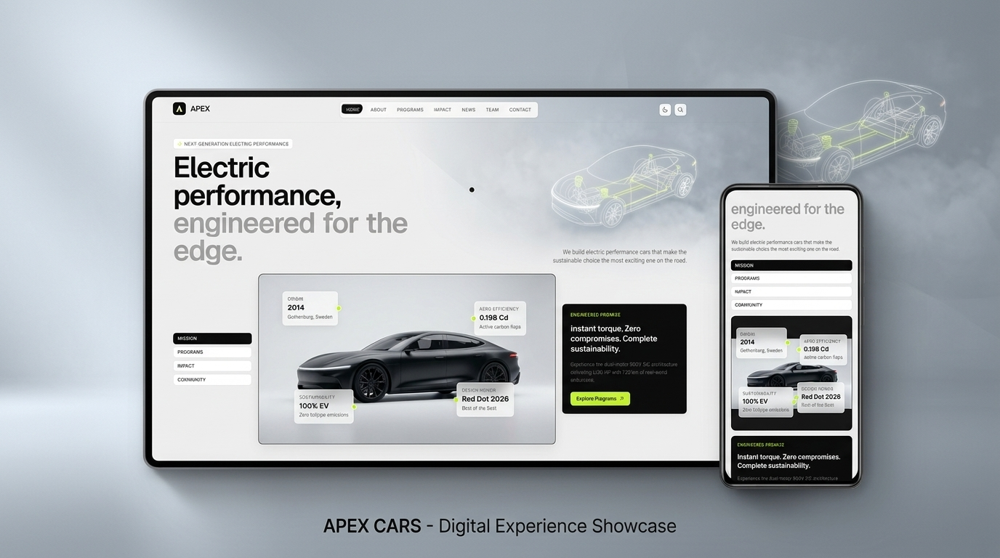

<p align="center">
  
</p>

<h1 align="center">⚡ Apex Cars — Electric Performance</h1>

<p align="center">
  <strong>The official web platform and digital experience for Apex Cars — Swedish high-performance electric vehicles engineered for the edge.</strong>
</p>

<p align="center">
  <a href="#-tech-stack"></a>
  <a href="#-tech-stack"></a>
  <a href="#-tech-stack"></a>
  <a href="#-tech-stack"></a>
  <a href="#-tech-stack"></a> 
</p>

---

## 🏎️ Overview

**Apex Cars** (founded 2014 in Gothenburg, Sweden) builds dual-motor 900V SiC electric grand tourers and track vehicles delivering up to 1,150 HP with 94.8% battery circularity.

This repository houses the brand's primary digital flagship — an editorial, motion-rich, static-site-generated web application built to mirror the precision engineering of Scandinavian automotive craft.

<p align="center">
  
</p>

---

## ✨ Key Highlights

- **Scandinavian Editorial Design System:** Sleek, modern geometry with tight micro-radii (`rounded-lg` / 8px), tailored typography hierarchy (Geist Sans & Mono), HSL tokens, and a luminous Swedish racing lime accent (`#C6F432`).
- **Kinetic Motion Architecture:**
  - **Lenis Smooth Scroll:** Hardware-accelerated inertial scrolling synchronized directly with GSAP's RAF ticker.
  - **ScrollTrigger Choreography:** Parallax vehicle staging, scrubbed speed telemetry counters, interactive 3D card perspective tilt, and magnetic navigation buttons.
  - **Desktop Custom Cursor:** Physics-spring cursor with magnetic element snap and automatic touch-screen deactivation.
- **Responsive Navigation:**
  - Sticky frosted header bar (`backdrop-blur-md`) with real-time route pill indicator tracking.
  - Full-screen animated mobile drawer menu with zero content clipping or obstruction.
- **Enterprise Engineering Discipline:**
  - **Zero file sprawl:** Strict CI enforcement limiting every file to $\le 250$ lines (`check-file-length.mjs`).
  - **Static Site Generation (SSG):** Fully pre-rendered routes via `vite-ssg` with instantaneous client hydration.
  - **PWA & Offline Capability:** Service worker caching, manifest, Brotli compression, and web app installability.
  - **Budget Enforced:** Sub-200 KB initial JS/CSS bundle budget checked on every production build.

---

## 🛠️ Tech Stack

| Domain                | Technology                                                                    | Rationale                                                              |
| --------------------- | ----------------------------------------------------------------------------- | ---------------------------------------------------------------------- |
| **Framework**         | [Vue 3](https://vuejs.org/) (Composition API, `<script setup>`)               | Lightweight reactivity, clean SFC structure, and high performance.     |
| **Tooling & Bundler** | [Vite 8](https://vite.dev/) + [@tailwindcss/vite](https://tailwindcss.com/)   | Instant HMR, native ESM dev server, optimized static builds.           |
| **SSG**               | [ViteSSG](https://github.com/antfu/vite-ssg)                                  | SEO-optimized static HTML pre-rendering with client hydration.         |
| **Styling**           | Tailwind CSS v4 + Vanilla CSS Design Tokens                                   | Zero-runtime CSS variables, strict color tokens, and fluid typography. |
| **Motion & Scroll**   | [GSAP](https://greensock.com/) + [Lenis](https://lenis.darkroom.engineering/) | Silky 60+ FPS scrub animations, parallax, and inertial scrolling.      |
| **Type Safety**       | TypeScript 5.9 + `vue-tsc`                                                    | Strict type checking with 0 `any` types.                               |
| **Testing**           | [Vitest](https://vitest.dev/) + [Playwright](https://playwright.dev/)         | Unit test suite for primitives + multi-browser cross-device E2E tests. |
| **PWA**               | [vite-plugin-pwa](https://vite-pwa-org.netlify.app/)                          | Offline cache, web manifest, and background icon registration.         |

---

## 📂 Architecture & Directory Structure

```
apex-cars/
├── docs/assets/               # GitHub repo hero banners & device mockups
├── public/                    # PWA manifest, favicons, robots.txt
├── scripts/
│   ├── check-budget.mjs       # Verifies dist size limits (<200KB JS, <50KB CSS)
│   └── check-file-length.mjs  # Enforces strict 250-line limit across all files
├── src/
│   ├── app/                   # App root, Vue Router, Pinia stores
│   ├── assets/images/         # High-resolution automotive photography assets
│   ├── components/
│   │   ├── layout/            # AppHeader, NavPills, MobileMenu, AppFooter, CustomCursor
│   │   ├── motion/            # ParallaxImage, RevealItem, SplitText
│   │   └── ui/                # BaseCard, BasePill, IconButton, StatTile, FilterChip
│   ├── composables/           # useGsap, useLenis, useCursor, useMagnetic, useTheme
│   ├── data/                  # Strongly-typed data models (specs, news, team, impact)
│   ├── features/home/         # Modular home page sections (Hero, Story, Grid, Cta)
│   ├── lib/                   # Formatting, easing curves, SEO metadata helper
│   ├── pages/                 # Route views (Home, About, Programs, Impact, News, Team, Contact, Kit)
│   └── styles/                # Tokens, Tailwind v4 imports, motion keyframes, utilities
└── tests/
    ├── e2e/                   # Playwright E2E test specs (desktop & mobile)
    └── unit/                  # Vitest component & helper unit tests
```

---

## 🚀 Getting Started

### Prerequisites

- **Node.js**: `v20.x` or `v22.x` (LTS recommended)
- **Package Manager**: `npm` or `pnpm`

### Installation

```bash
# Clone the repository
git clone https://github.com/your-username/apex-cars.git
cd apex-cars

# Install dependencies
npm install
```

### Development Server

Start the local Vite dev server with hot module replacement:

```bash
npm run dev
```

Visit `http://localhost:5173` to explore the site in your browser.

---

## 🧪 Testing & Verification

Apex Cars enforces automated quality checks covering code formatting, strict TypeScript types, file sizes, and behavior tests:

```bash
# Run all checks (file lengths, ESLint, vue-tsc, and Vitest)
npm run check

# Run unit tests only
npm run test

# Run End-to-End tests with Playwright (Desktop + Mobile)
npm run test:e2e

# Build production SSG bundle and verify bundle budget (<200 KB)
npm run build
```

---

## 🎨 Design System Primitives (`/kit`)

Explore the live component playground by navigating to `/kit` in your browser. Primitives include:

- `<BasePill>`: Compact 8px border-radius button with active indicator state and outline/solid/accent variants.
- `<IconButton>`: Accessible, magnetic circular/rounded icon buttons with fluid hover physics.
- `<BaseCard>`: 3D perspective tilt cards supporting dark, surface, and frosted glass modes.
- `<StatTile>`: Animated numerical counter cards featuring easing-driven digit rolls.
- `<FilterChip>`: Dynamic multi-category filter toggles with active status indicators.

---

## 📄 License

Distributed under the **MIT License**. See `LICENSE` for more information.

---

<p align="center">
  <sub>Engineered with precision in Gothenburg, Sweden. Designed for the edge.</sub>
</p>
